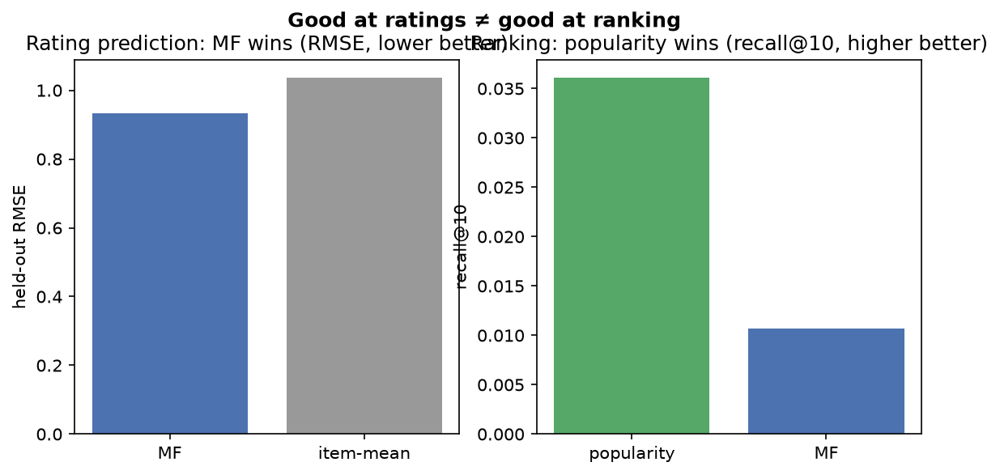
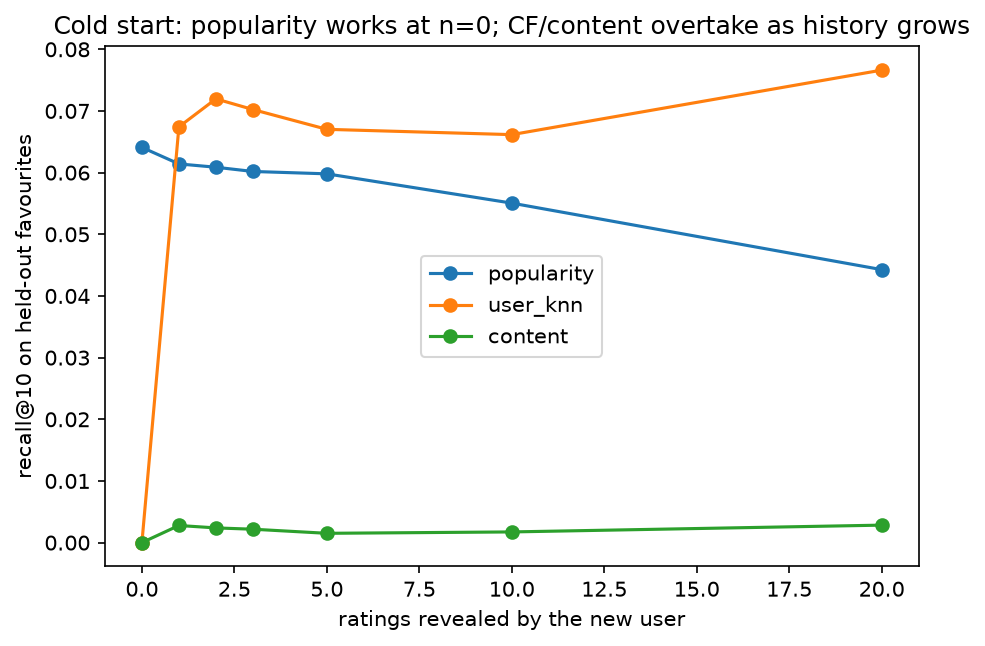
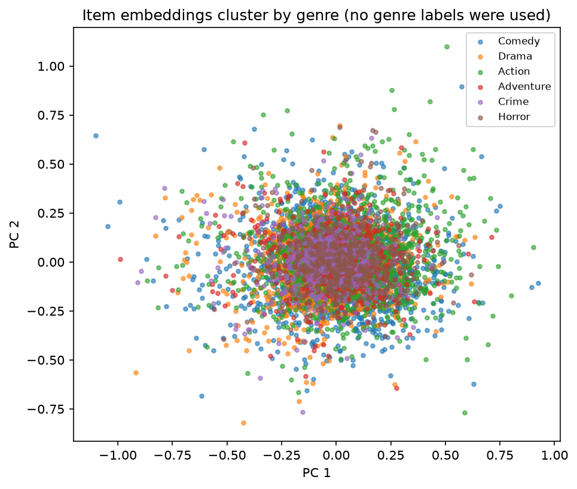

# recommender_101

> **Your fancy recommender loses to "most popular" half the time.**
> A hands-on introduction to how recommendation actually works — built from scratch, on CPU.

Recommendation looks like black magic from the outside. It isn't. **Collaborative filtering** is just
*"find people similar to you and copy their taste."* **Matrix factorization** is just *compression* —
squeezing a giant, mostly-empty ratings table into a few hidden "taste" dimensions per user and per item.
And the embarrassingly simple **"recommend whatever is most popular to everyone"** baseline is so strong
that, measured honestly, the sophisticated methods often *lose to it*.

This repo builds all of it from scratch — no `surprise`, no `implicit`, no `lightfm` — on **MovieLens-small**,
inside a 2-CPU / 8 GB GitHub Codespace, and benchmarks every method against popularity the way an honest
recommender project should. Six runnable notebooks, a `src/` library, and a Streamlit app.

`Python 3.11+` · `uv` · CPU-only, no GPU · `Apache-2.0`

---

## The result in one table

Leave-last-out evaluation on MovieLens-small (610 users, 9,724 movies, 100k ratings), top-10 lists,
full-catalog ranking. Numbers are reproduced live in the notebooks and saved to
[`outputs/data/04_scoreboard.json`](outputs/data/04_scoreboard.json).

| Method | recall@10 | NDCG@10 | coverage | novelty | the honest verdict |
|---|---:|---:|---:|---:|---|
| **Popularity** (baseline) | 0.036 | 0.021 | 1.3% | 1.43 | the bar — ignores the user entirely |
| User-kNN CF | 0.062 | 0.036 | 3.1% | 1.85 | beats popularity, modestly |
| **Item-kNN CF** | **0.069** | **0.040** | 7.4% | 2.47 | **the accuracy winner** |
| Matrix factorization | 0.011 | 0.007 | 5.7% | 4.78 | **loses to popularity at top-N** (yet wins on RMSE) |
| Content-based | 0.003 | 0.001 | **15.2%** | **7.15** | least accurate, most novel |

The fanciest method — matrix factorization — is a brilliant *rating predictor* (it beats an item-average
baseline on RMSE) and yet it **ranks worse than "most popular"** at the top-N task we actually care about.
That is not a bug; it is the famous RMSE-vs-ranking gap (Cremonesi 2010; Rendle 2020). Meanwhile popularity
has the *worst* discovery (coverage, novelty, diversity) of everything in the room — a cost the accuracy
columns hide.



---

## What you'll learn (the six notebooks)

Each notebook is standalone, runs in well under 6 minutes on 2 CPUs, and saves its figures to
[`outputs/figures/`](outputs/figures/) and its numbers to [`outputs/data/`](outputs/data/).

| # | Notebook | The point |
|---|---|---|
| 01 | [The Popularity Baseline](notebooks/01_the_popularity_baseline.ipynb) | Honest evaluation setup, and the rule: **report popularity first, always.** |
| 02 | [Collaborative Filtering](notebooks/02_collaborative_filtering.ipynb) | CF = cosine similarity + copying, in code. It beats popularity — but modestly, and it falls apart for sparse users. |
| 03 | [Matrix Factorization](notebooks/03_matrix_factorization.ipynb) | Compression into learned taste embeddings; recovers planted structure; clusters by genre with no labels — then **loses to popularity at ranking.** |
| 04 | [The Arena](notebooks/04_arena.ipynb) | All five methods × every metric. The honest, two-sided scoreboard. |
| 05 | [Cold Start](notebooks/05_cold_start.ipynb) | New users break every personalized method; popularity holds. Framed as **explore–exploit.** |
| 06 | [Decision Framework](notebooks/06_decision_framework.ipynb) | A one-page guide for choosing a method, plus the offline/online caveat. |

<p align="center">
  
  
</p>

---

## Quickstart

```bash
make setup      # install uv + dependencies, register the Jupyter kernel
make data       # download & cache MovieLens-small into data/
make test       # run the test suite (19 tests)
make notebooks  # execute all six notebooks end-to-end
make run        # launch the Streamlit app
make ci         # what CI runs: sync + lint + test
```

Everything runs on CPU. The heaviest step (matrix-factorization SGD + the full arena) takes under a minute.

---

## The five recommenders (all from scratch)

- **Popularity** — rank items by how many people rated them; recommend the top ones to everyone. The yardstick.
- **User-based kNN CF** — find the most similar users (cosine over rating vectors), copy what they liked.
- **Item-based kNN CF** — the dual: recommend items similar to the ones you already liked. More stable at scale.
- **Matrix factorization (SGD)** — learn user & item embedding matrices; a dot product predicts the rating.
- **Content-based** — recommend items whose features (genres) match your taste; works for brand-new items.

Implementations live in [`src/recommenders/`](src/recommenders/) and are written to be *read* — the code is
the explanation.

## How it's evaluated (honestly)

- **Leave-last-out per user** ([`src/evaluation/splits.py`](src/evaluation/splits.py)) — hold out each
  user's most recent interactions; no held-out rating ever leaks into training (asserted in tests).
- **Ranking metrics, not accuracy** ([`ranking.py`](src/evaluation/ranking.py)) — precision@k, recall@k,
  NDCG@k, MAP, catalog coverage.
- **Beyond accuracy** ([`beyond_accuracy.py`](src/evaluation/beyond_accuracy.py)) — novelty, diversity,
  popularity bias, because a recommender that only surfaces hits offers no discovery.
- **The arena** ([`comparison.py`](src/evaluation/comparison.py)) — one harness, every method, the
  popularity line drawn through the scoreboard.

## Project layout

```
src/
  config.py            # typed settings from config/settings.yaml (pydantic)
  recommenders/        # popularity, user_knn, item_knn, matrix_factorization, content
  data/ratings.py      # MovieLens loader (cached) + synthetic planted-structure generator
  evaluation/          # splits, ranking, beyond_accuracy, comparison (the arena)
  artifacts.py         # save figures as PNG, results as JSON
  visualisation.py     # shared plotting helpers
notebooks/             # 01..06, executed with outputs embedded
app/streamlit_app.py   # interactive explorer
tests/                 # 19 tests guarding every claim the project makes
outputs/figures/*.png  # every notebook figure
outputs/data/*.json    # every notebook result
```

## The Streamlit app

```bash
make run
```

Four views: **Recommend-to-me** (top-k from each method side by side), **Baseline showdown** (every method
against the popularity line), and a **Cold-start simulator** (watch CF fail on a new user, then take over as
you add ratings).

---

## Related projects

This is one of the [Dima806](https://github.com/Dima806) "101" builds; each chapter here leans on an idea
developed in its own repo:

- [**embeddings_101**](https://github.com/Dima806/embeddings_101) — matrix factorization *is* embeddings:
  the same learned vectors, applied to users and items.
- [**gradient_descent_101**](https://github.com/Dima806/gradient_descent_101) — the SGD optimizer that
  trains the matrix-factorization model here, from scratch.
- [**distance_arena**](https://github.com/Dima806/distance_arena) — which similarity/distance metric to
  trust: the choice at the heart of neighborhood collaborative filtering.
- [**metrics_101**](https://github.com/Dima806/metrics_101) — why *ranking* metrics (NDCG, recall@k), not
  accuracy/RMSE, are the right way to judge a recommender.
- [**train_test_leakage_demo**](https://github.com/Dima806/train_test_leakage_demo) — how a careless split
  leaks the future into training; the trap the leave-last-out split here is built to avoid.
- [**bandits_101**](https://github.com/Dima806/bandits_101) — cold-start as the explore–exploit problem:
  you must recommend something to *learn* a new user's taste.

---

## References

- Sarwar, B. et al. (2001). *Item-Based Collaborative Filtering Recommendation Algorithms.* WWW.
- Koren, Y., Bell, R., Volinsky, C. (2009). *Matrix Factorization Techniques for Recommender Systems.* IEEE Computer.
- Cremonesi, P., Koren, Y., Turrin, R. (2010). *Performance of Recommender Algorithms on Top-N Recommendation Tasks.* RecSys.
- Harper, F.M., Konstan, J. (2015). *The MovieLens Datasets: History and Context.* ACM TiiS.
- Rendle, S. et al. (2020). *Neural Collaborative Filtering vs. Matrix Factorization Revisited.* RecSys.
- Herlocker, J. et al. (2004). *Evaluating Collaborative Filtering Recommender Systems.* ACM TOIS.

## License

[Apache-2.0](LICENSE). MovieLens data © GroupLens Research, used under its research license.
